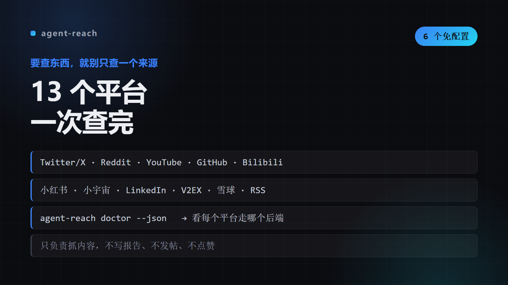

# agent-reach

MUST USE when user wants to research/search/look up/find anything on the internet — e.g. "research this topic", "do a deep dive on X", "search the web for X", "see what people say 

## 📺 看看效果




## What This Does

MUST USE when user wants to research/search/look up/find anything on the internet — e.g. "research this topic", "do a deep dive on X", "search the web for X", "see what people say 

### Key Features

- Routing table
- Zero-config quick commands
- Environment check
- Workspace rules
- Detailed references
- Configure a channel
- [Search](references/search.md) — Exa AI search
- [Career](references/career.md) — LinkedIn

## Installation

### WorkBuddy

```bash
git clone https://github.com/<you>/agent-reach.git ~/.workbuddy-ai/skills/agent-reach
pip install -r ~/.workbuddy-ai/skills/agent-reach/requirements.txt
```

### Claude Code / 其他 Agent

```bash
mkdir -p ~/.claude/skills/agent-reach
cp -R SKILL.md README.md requirements.txt scripts references \
      ~/.claude/skills/agent-reach/
```

把仓库链接丢给 agent，它会按 `SKILL.md` 加载所需文件。

## Usage

```bash
mcporter call 'exa.web_search_exa(query: "query", numResults: 5)'
twitter search "query" -n 10
```

## Architecture

| 文件 | 作用 |
|---|---|
| `SKILL.md` | 触发条件与流程 |

## Requirements

- Python 3.9+
- `pip install -r requirements.txt`

## Credits

Created by 公子 · [@你的GitHub](https://github.com/).

## 工具箱

<p>
  <a href="https://github.com/chengangrun-ai/agent-reach"></a>
  <a href="https://github.com/chengangrun-ai/cleanup-junk"></a>
  <a href="https://github.com/chengangrun-ai/mt5-ex5-fallback"></a>
  <a href="https://github.com/chengangrun-ai/camiai-programming-workflow"></a>
</p>

> 四个工具，一个共同点：只读先行，动手前先给你看报告。

## License

MIT — Use it, modify it, share it.
